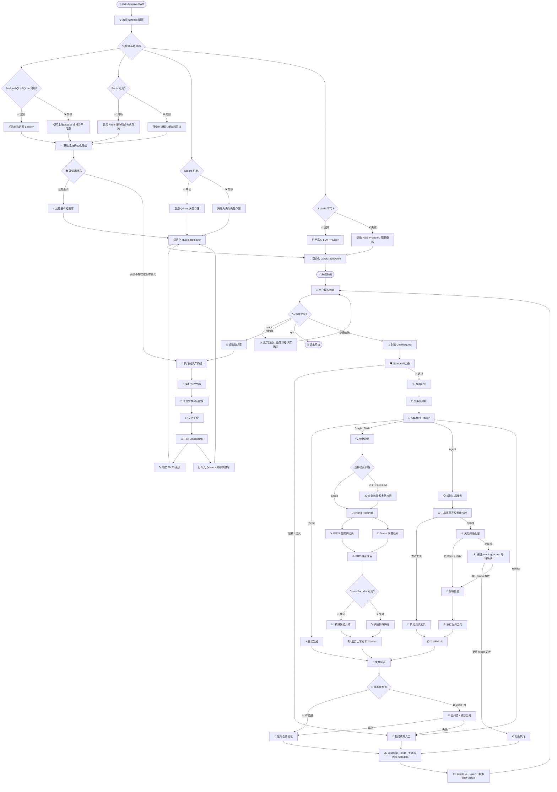
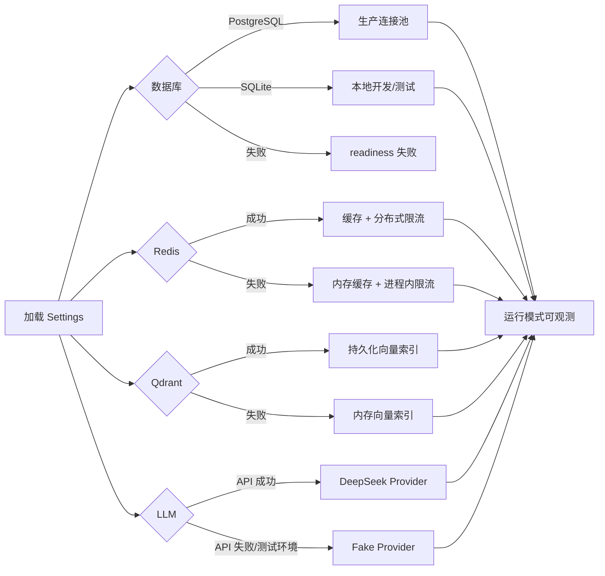
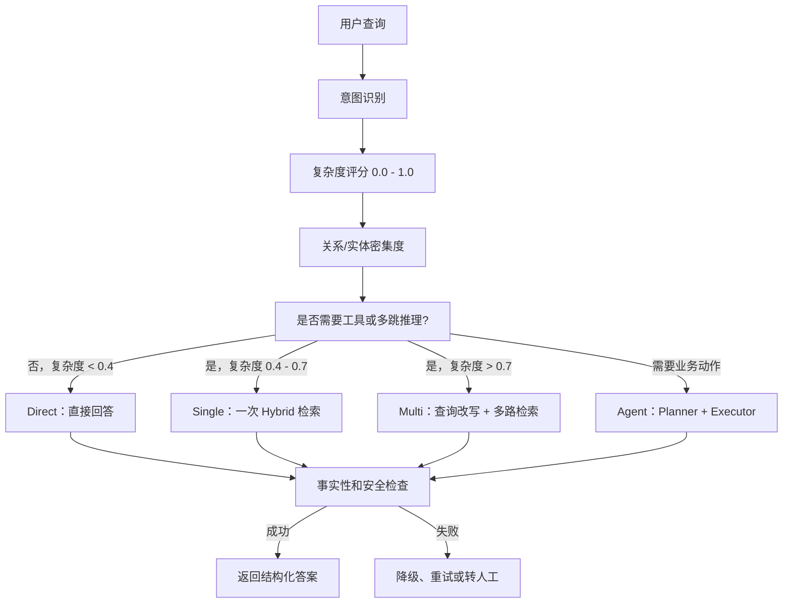
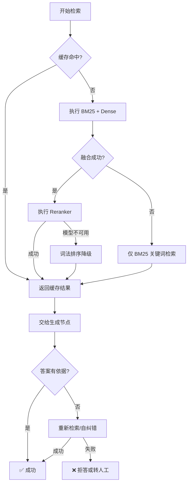

# Adaptive-RAG 项目架构图

这张图按照“启动检查 → 知识库准备 → 查询分析 → 智能路由 → 检索/工具执行 → 生成回答 → 观测统计”的运行顺序绘制。所有节点和降级路径均对应当前仓库中的实际模块。

## 一、系统主流程

## 二、启动与依赖降级

当前代码对应关系：

| 架构节点 | 代码位置 |
| --- | --- |
| Settings 配置 | `app/config/settings.py` |
| 生命周期与 API | `app/main.py`、`app/asgi.py` |
| 基础设施组合 | `app/services/container.py` 的 `build_infrastructure` |
| 检索组件组合 | `app/services/container.py` 的 `build_retrieval` |
| Redis 和限流 | `app/infra/redis_client.py`、`app/infra/rate_limit.py` |
| 知识库 ingest | `app/retrieval/ingest.py` |
| 文档解析清洗切块 | `app/retrieval/unstructured_parser.py`、`cleaning.py`、`chunking.py` |
| BM25 和向量检索 | `app/retrieval/bm25.py`、`vector.py` |
| Hybrid 和 RRF | `app/retrieval/hybrid.py`、`fusion.py` |
| Agent Graph | `app/agents/graph.py` |
| 路由和状态 | `app/agents/nodes/router.py`、`app/agents/state.py` |
| 工具权限与执行 | `app/tools/permissions.py`、`app/agents/nodes/executor.py` |
| 事实性检查 | `app/guardrails/hallucination.py`、`app/agents/nodes/faithfulness.py` |
| API 输出 | `app/api/routes/chat.py`、`app/schemas/chat.py` |
| 指标和日志 | `app/observability/` |

## 三、查询策略路由图

## 四、检索降级链路

## 五、图例

| 图形/标记 | 含义 |
| --- | --- |
| `✅` | 当前步骤成功，继续主流程 |
| `❌` | 当前依赖或处理失败 |
| `⚡` | 低延迟或直接路径 |
| `🔄` | 重试、融合或循环 |
| `⏸️` | 暂停等待用户确认 |
| `⬇️` | 降级到成本更低、能力更弱的实现 |
| `🛡️` | 安全、边界或权限控制 |

这张图与 All-in-RAG 中“数据准备 → 索引构建 → 检索优化 → 生成评估 → 项目实战”的学习顺序对应，但把本项目特有的 Agent 路由、工具权限、确认机制和运行时降级也放进了同一张图中。
